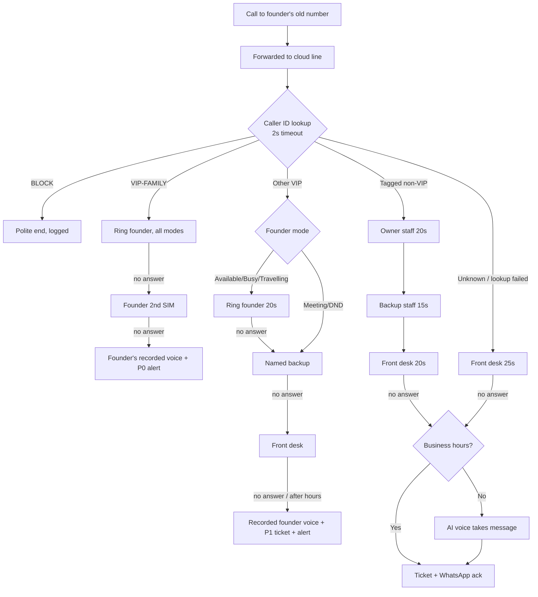
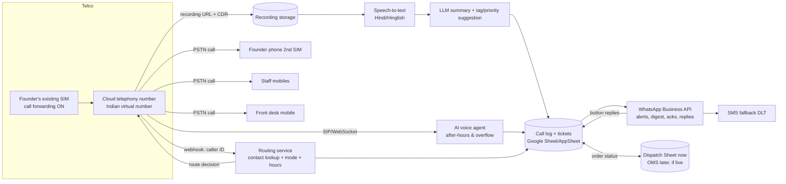

# Call Desk System — Design & Rollout Plan

> **Status:** v1 design built on stated assumptions (founder said "assume").
> Every vendor capability and price below is an **estimate to verify** with the vendor
> before purchase. Compliance notes are a practical guide, **not legal advice** — confirm
> with your CA/lawyer.

---

## 0. Assumptions used (correct any that are wrong — the design adapts)

This repo holds an OMS built for the business (orders, picking, dispatch), but it is
**not live yet**. Today orders run on WhatsApp + Tally + Excel. The assumptions are
anchored to a **small manufacturing + trading business in the Hindi belt**, and **nothing
in this call desk depends on the OMS going live**.

| # | Area | Assumption |
|---|---|---|
| A1 | Business | Manufacturer + trader, B2B to dealers/retailers + some direct buyers. Turnover ₹8–25 cr/yr. Orders ₹15k–₹10 lakh, average ~₹80k. ~60 active repeat buyers; top 15 = ~60% of revenue. |
| A2 | Volume | ~120 incoming calls/day + ~40 outgoing. Founder answers ~70, misses ~50 (30–40%). Avg call 3 min → **~3.5–4.5 hrs/day on phone**. |
| A3 | Peaks | 10:30–13:30 and 16:00–19:30. 8–12 calls after 20:00. Sunday ≈ 40% volume. |
| A4 | Caller mix | Buyers 30% · suppliers/vendors 15% · staff 15% · transport/drivers 10% · new leads 8% · spam/unknown 8% · family/personal 5% · bank/NBFC/CA 5% · brokers/partners 3% · govt/legal 1%. ~70% repeat numbers, ~30% new. |
| A5 | Language | Hindi/Hinglish 85%, regional (Marwari, Haryanvi, Bhojpuri, Punjabi) 10%, English 5% (banks, corporates). |
| A6 | WhatsApp | ~85% of callers use WhatsApp; ~60% read simple Hindi/Hinglish; ~25% are "voice-only"; drivers/labour often on JioPhone/basic phones. |
| A7 | Phones | One personal mobile number (Jio/Airtel postpaid) on all bills, boards, GST. Second SIM for family. No landline. **Callers must keep dialling the same number.** |
| A8 | Staff | **Sunita** – accounts/bank/GST · **Rohit** – sales/orders · **Ramesh** – dispatch/warehouse/transport · **Vikram** – purchase/production/suppliers · **Deputy** – senior manager or family member. (Names are placeholders.) Callback reliability today ~3/5. |
| A9 | Front desk | None today. Willing to hire one at ₹12–16k/month, in office, 10:00–19:00 Mon–Sat. |
| A10 | VIPs | ~40 numbers: 2 bank RMs, CA, lawyer, top 15 buyers, 5 key suppliers, 3 brokers/partners, ~10 family/close friends. |
| A11 | Emergencies | Vehicle accident, truck held at checkpost/police, payment failure/cheque bounce, GST/IT/labour notice or inspection, factory fire/injury, family medical, top buyer threatening cancellation. |
| A12 | Must never | Bot talking to a VIP; staff quoting prices/discounts/credit; leak of finance or personal recordings; alert spam; callers feeling brushed off. |
| A13 | Tools | WhatsApp Business app, Tally Prime, Excel, Google account. OMS built but **not live**. No single list of buyer/vendor phone numbers. Office broadband + Jio hotspot backup. |
| A14 | Budget/speed | ₹15–25k/month tech (excluding salary), ₹50k–1.5 lakh one-time. Phase 0 live this week. |
| A15 | Founder's day | Mornings in office; afternoons market/factory/bank; travels 4–6 days/month. Will reply to WhatsApp with a tap or a number, but not more than ~10 times a day. |

---

## 1. Executive Summary (Founder lens)

**The problem in numbers (estimated)**
- ~120 calls/day; you personally handle ~70 and miss ~50.
- ~3.5–4.5 hours/day on the phone, broken into 2–3 minute interruptions.
- ~12–15 missed calls/day are buyers. If even 2–4 orders a week (~₹80k each) slip to a
  competitor because nobody called back, that's **₹6–13 lakh/month of revenue at risk**.
- Nobody owns callbacks, so callers learn that "only Sir's phone works".

**The solution in 5 lines**
1. Your existing number stays. Behind it, a cloud phone line recognises **who** is calling
   and silently rings the right person — VIPs always reach you.
2. A **front-desk person** answers everyone else in a warm Hindi voice and routes or
   resolves in under 30 seconds. No menus, no "press 1".
3. Every missed or pending call becomes a **callback ticket** with an owner and a deadline;
   the caller gets a plain-Hindi WhatsApp: "Aapka call aaya tha, aaj shaam tak call back hoga."
4. AI only **assists**: records, transcribes, fills the call log, flags urgency, writes
   summaries. An AI voice answers **only** after hours or when every human is busy.
5. You get **real-time alerts only for emergencies and VIPs**, one evening WhatsApp digest,
   and one-tap actions: *I'll call / Give to Ramesh / Done / Ignore*.

**Expected outcome (targets after ~6 weeks)**

| Metric | Today (est.) | Target |
|---|---|---|
| Founder phone time | 3.5–4.5 h/day | **1–1.5 h/day** (saves ~2.5–3 h) |
| Calls answered or acknowledged | ~60% | **≥ 98%** |
| Missed buyer calls not called back same day | ~10/day | **≤ 1/day** |
| Calls resolved without founder | ~0% | **55–65%** |

**Monthly cost (estimate, verify):**
- Tech: **₹14–28k/month** (cloud telephony, transcription, WhatsApp API, AI voice after hours, log).
- Front desk: **₹12–16k/month** salary.
- One-time setup by a freelancer: **₹50k–1.2 lakh**.
- One saved order a month (~₹80k revenue, ₹8–15k margin) plus 60+ founder hours a month
  covers it.

---

## 2. Caller & Intent Taxonomy

Urgency: **P0** = interrupt now (live to founder/deputy, ≤15 min) · **P1** = callback within
2 business hours · **P2** = same day by 19:00 · **P3** = next business day / FYI.

| Caller type | How identified | Common intents | Urgency | Default handling | Info to capture |
|---|---|---|---|---|---|
| **Family / personal VIP** | Tagged number (`VIP-FAMILY`) | Personal, emergencies | P0 | **Founder live, always** (rings through every mode incl. DND). **Not recorded.** | Nothing (only "missed" alert) |
| **Bank RM / NBFC / CA / lawyer** | Tagged (`VIP-FINANCE`) | Limits, documents, signatures, renewals, audit | P0–P1 | **Founder live**; if no answer → Sunita for documents, founder ticket P1 | Topic, documents needed, deadline |
| **Top buyer (top 15)** | Tagged (`BUYER-TOP`) | New order, rate, delivery, complaint, payment | P0–P1 | **Founder live**; no answer → Rohit (orders) → front desk; founder alert | Order ref, qty, delivery date, complaint |
| **Regular buyer** | Tagged (`BUYER`) | Order, dispatch status, rate, ledger, complaint | P1–P2 | **Rohit live** (orders/rates); dispatch → Ramesh; ledger → Sunita | Firm, order no., item, qty, issue |
| **New buyer / sales lead** | Unknown number → front desk asks | Enquiry, catalogue, rate, sample | P1 (fresh lead decays fast) | **Front desk** → Rohit live; else ticket P1 to Rohit | Name, firm, city, product, qty, how they found us |
| **Key supplier (top 5)** | Tagged (`VENDOR-KEY`) | Payment, supply dates, rate change | P1 | Founder live → Vikram → ticket | Bill no., amount, due date, material |
| **Supplier / vendor** | Tagged (`VENDOR`) | Payment chasing, delivery, new offer | P2 | **Vikram** (supply) / **Sunita** (payment) | Bill no., amount, promised date |
| **Staff** | Tagged (`STAFF`) | Approval, problem, leave, emergency | P0–P2 | Direct to founder **only in Available mode**; otherwise front desk/deputy; emergency keywords → founder | What approval, amount, by when |
| **Transport / driver** | Tagged (`TRANSPORT`) or front desk asks | Location, unloading, payment, challan, breakdown, accident | P1 (P0 if accident/held) | **Ramesh live** → front desk | Vehicle no., location, order, problem |
| **Broker / partner** | Tagged (`PARTNER`, VIP if key) | Deals, rates, leads | P1–P2 | Founder live (VIP) else ticket to founder | Deal, party, value |
| **Govt / compliance / legal** | Tagged if known; else front desk asks | Notice, inspection, GST query, summons | **P0** | Front desk **never handles content**: warm transfer to founder/deputy; else P0 ticket + alert | Department, officer name, reference, deadline |
| **Job seekers / misc** | Front desk asks | Jobs, donations, misc | P3 | Front desk resolves (take details) | Name, purpose |
| **Telemarketing / spam** | Truecaller-style flag, front desk tags `BLOCK` | Loans, insurance, sales pitches | — | Front desk ends politely, tags `BLOCK` → future calls get a polite "not interested" or auto-hangup | Number only |
| **Unknown (unclear)** | Not in contacts | Anything | P2 by default | **Front desk** identifies → routes; after hours → AI voice takes message | Name, firm/place, purpose, callback number |

**Rule of thumb:** a known number never meets a question it shouldn't need to answer.
Unknown numbers meet a human first, except after hours.

---

## 3. Contact Tagging Plan

**Goal:** about 300 numbers tagged in 2 days covers ~70% of call volume.

### 3.1 First-time tagging (Day 1–2, ~4 hours total)

| Step | Who | How |
|---|---|---|
| 1. Export call history (last 60–90 days) | Freelancer/front desk with founder's phone | Android: an app such as *Call Log Backup & Restore* or Google account export → CSV. iPhone: no native export; use the WhatsApp/contact list + operator itemised bill (Jio/Airtel postpaid bill lists every number). |
| 2. Rank numbers by frequency | Freelancer | Google Sheet pivot: number → call count. The top ~300 numbers cover most volume. |
| 3. Export phone contacts | Freelancer | Google Contacts → Export CSV (names already saved). Merge with step 2. |
| 4. **Founder tags in one 45-min sitting** | Founder + front desk reading out | For each number, one tag from the list below + **owner staff**. Do it fast: "Sharma Traders — buyer-top, Rohit". |
| 5. Add from Tally + Excel | Sunita | Phone numbers from Tally ledger masters (sundry debtors → `BUYER`, sundry creditors → `VENDOR`) and any Excel party lists. Tally ledgers often lack phone numbers; fill gaps from WhatsApp chats over the following weeks. |
| 6. Staff and transporters | Ramesh/Sunita | Staff list + regular transporters/drivers. |

**Tag list (one primary tag per number):**
`VIP-FAMILY · VIP-FINANCE · BUYER-TOP · BUYER · LEAD · VENDOR-KEY · VENDOR · STAFF ·
TRANSPORT · PARTNER · GOVT · BLOCK`
**Plus fields:** `owner_staff`, `language` (Hindi/Marwari/English…), `voice_only` (Y/N),
`record` (Y/N, default N for VIP-FAMILY), `notes`.

### 3.2 Who maintains it
- **Front desk owns the contact sheet.** Only the founder can set or remove VIP tags.
- **Weekly 10-min review** (Saturday): front desk shows the founder new numbers with
  ≥2 calls that week; founder confirms the tag.

### 3.3 New callers get tagged after their first call
- After every call from an unknown number, the call-log row has a **required "Tag"
  dropdown**. The front desk picks it before closing the row (one tap).
- The AI summary (Phase 2) **suggests** a tag ("Sounds like a new buyer from Jaipur → LEAD")
  and the front desk confirms. AI never auto-assigns VIP.
- Anyone who calls 3+ times with no tag shows up in the digest as "Untagged frequent caller".

---

## 4. Routing & Escalation Rules

### 4.1 Decision tree (plain language)

```
CALL ARRIVES on the founder's old number → forwarded to the cloud line
│
├─ 1. Look up caller ID in contact sheet (timeout 2 s; on failure → treat as UNKNOWN)
│
├─ 2. Is it BLOCK? → play "Dhanyavaad, abhi zaroorat nahi hai" → end. (Logged.)
│
├─ 3. Is it VIP-FAMILY? → ring founder (all modes) → no answer → ring founder's 2nd SIM
│      → no answer → founder's pre-recorded voice "Main thodi der mein call karta hoon"
│      → P0 ticket + instant WhatsApp alert. NEVER AI. NEVER recorded.
│
├─ 4. Is it another VIP (FINANCE / BUYER-TOP / VENDOR-KEY / key PARTNER / GOVT)?
│      → ring founder (unless mode = Meeting/DND: then skip straight to step b)
│        a. no answer in 20 s → ring the named backup (Sunita / Rohit / Vikram / Deputy)
│        b. no answer → front desk ("Sir abhi meeting mein hain, main note kar leti hoon")
│        c. after hours / nobody → founder's pre-recorded voice message → P1 ticket
│           to founder + real-time alert. NEVER AI.
│
├─ 5. Is it a tagged non-VIP (BUYER / VENDOR / TRANSPORT / STAFF / LEAD)?
│      → ring owner_staff (20 s) → ring backup staff (15 s) → front desk (20 s)
│      → if all busy/no answer: business hours → ticket + WhatsApp ack;
│        after hours → AI voice takes message → ticket.
│      (STAFF calling founder: ring founder only in Available mode; else Deputy.)
│
├─ 6. UNKNOWN number
│      → business hours: front desk (25 s) → founder (only in Available mode) → AI overflow
│      → after hours: AI voice assistant takes message → ticket
│
└─ 7. Every call ends in exactly one state: RESOLVED · TRANSFERRED · TICKET · BLOCKED.
       Anything not RESOLVED gets a ticket + WhatsApp acknowledgement to the caller.
```



### 4.2 Founder availability modes

Set by sending one word to the office WhatsApp bot (`A`, `B`, `M 4pm`, `D`, `T`), or with a
home-screen shortcut. The mode shows in every alert. **If mode data is unreachable, the
system behaves as Available.** That's the fail-safe: rings a human.

| Mode | What rings you live | What changes | Alerts |
|---|---|---|---|
| **A – Available** | All VIPs + staff + unknown overflow | Normal routing | P0 + VIP-missed real-time |
| **B – Busy** | VIPs only | Staff → Deputy; unknown → front desk only | P0 + VIP-missed real-time |
| **M – Meeting** (with end time, e.g. `M 4pm`) | VIP-FAMILY + **P0 escalations only** | VIPs go to named backup, then front desk with "meeting mein hain, [time] tak call back" | P0 only real-time; rest bundled when the meeting ends |
| **D – DND** (night/personal) | VIP-FAMILY + repeat-caller P0 only | Everything else → tickets; AI after hours for non-VIP | P0 only |
| **T – Travelling** | VIPs + P0 | Deputy acts as "founder" for staff approvals up to a set limit (e.g. ₹25k); front desk promises "kal tak" callbacks | P0 + VIP-missed; digest twice a day |

**Override from the phone:** reply `VIP 98xxxxxx` to make a number VIP instantly, `BLOCK
98xxxxxx` to block, `PUT 98xxxxxx` to "always put this person through today".

### 4.3 Fallback chain when staff don't pick up
`Owner staff (20 s) → Backup staff (15 s) → Front desk (20 s) → [after hours: AI voice] →
Ticket + caller acknowledgement`. Total ring time stays **under ~55–60 s** before the caller
hears something. Callers hang up after about a minute of ringing.

Staff phones are rung as **normal mobile calls (PSTN), not an app**. That way it works on
any phone and doesn't need office internet.

### 4.4 Escalation triggers (any one → P0: try founder/deputy live + instant alert)

| Trigger | Detected by (Phase 1) | Detected by (Phase 2+) |
|---|---|---|
| **Keywords:** *accident, gaadi palat gayi, truck pakda, checkpost, police, challan, notice, GST wale aaye, inspection, raid, court, case, cheque bounce, cheque wapas, payment fail, paisa nahi aaya (from a bank/top buyer), aag, hospital, injury, order cancel kar denge, maal reject* | Front desk hears it → taps **"Escalate"** | Post-call transcript scan flags missed ones; live keyword spotting only if Phase 3 tests prove reliable |
| **Repeat calls:** same number ≥2 calls in 10 min, or ≥3 in 30 min | Telephony rule (automatic) | Same |
| **High value:** `BUYER-TOP`, or the buyer has a pending order ≥ ₹2 lakh | Tag (automatic) | Lookup in the Dispatch Sheet (automatic); OMS later if it goes live |
| **Angry/upset tone** | Front desk taps "Upset" | AI sentiment as a hint only, never alone |
| **Govt / legal caller** | Tag or front desk | Same |
| **VIP missed twice in a day** | Automatic | Same |

**Tension:** the Builder wants automatic keyword detection on live calls, but Hindi speech
recognition on noisy roadside calls will misfire. The Founder doesn't want false alarms
in meetings. **Recommendation:** humans escalate live; the machine catches what humans
missed after the call. Revisit live detection in Phase 3 with real error-rate data.

---

## 5. Front-Desk Playbook (human)

### 5.1 Who and when
- **One front-desk person** (Hindi/Hinglish fluent, calm, phone-friendly; ideally knows a
  regional language callers use). 10:00–19:00 Mon–Sat; lunch cover by the Deputy or
  overflow to the AI.
- Equipment: their own mobile on the cloud line (rings as a normal call) plus a laptop or
  tablet with the call log open.

### 5.2 Greeting
- **Unknown caller:** *"Namaste, [Company] se Pooja bol rahi hoon. Bataiye ji, kaise madad karoon?"*
- **Known caller (name shows on screen/WhatsApp ping):** *"Namaste Sharma ji! Bataiye."*
- **Founder's VIP fallback:** *"Namaste Sharma ji, Sir abhi meeting mein hain. Main unhe
  abhi message kar deti hoon, aap bataiye kya kaam tha?"*

### 5.3 The 30-second identify-and-route method (3 questions max, asked naturally)
1. **Kaun?** *"Aapka shubh naam? Kahan se bol rahe hain?"* (name + firm/town)
2. **Kya kaam?** *"Kis baare mein baat karni thi — order, payment, maal, ya kuch aur?"*
   (Spoken as a natural question. It is not a menu.)
3. **Kitna zaroori?** Only if unclear: *"Aaj hi ho jaana chahiye ya kal tak chalega?"*

Then: **transfer live** ("Ek minute, Rohit ji se baat karwa rahi hoon") **or resolve** **or
ticket** ("Rohit ji 2 baje tak aapko call karenge, isi number par?").
**Warm transfer:** announce the caller to staff in one line before connecting: "Sharma
Traders Indore, 50 bags ka order dispatch kab hoga."

### 5.4 What the front desk can resolve alone
Office address/timings, which staff handles what, receiving documents ("WhatsApp par bhej
dijiye"), dispatch status **read from the Dispatch Sheet** (status only: Pending / Loaded /
Dispatched + vehicle no.; see §9.6), taking orders **as a message** for Rohit, job enquiries, spam, rescheduling
callbacks.

### 5.5 What the front desk must NEVER commit to
❌ Prices, rates, discounts · ❌ Credit or payment terms · ❌ Confirming a payment was
received or sent · ❌ Delivery dates not written in the Dispatch Sheet · ❌ Sharing bank account
details (fraud risk; only the accountant sends them, and only from the official
letterhead/PDF) · ❌ The founder's location or personal number · ❌ Anything on
legal/government matters beyond taking the name and reference.
**Magic sentence:** *"Yeh main confirm nahi kar sakti, [Name] ji aapko [time] tak call karke
batayenge."*

### 5.6 How AI supports the front desk

| Feature | Phase | What they see |
|---|---|---|
| Caller tag + name + owner staff on ring | 1 | WhatsApp ping / log row: "📞 Sharma Traders · BUYER-TOP · Rohit" |
| Auto-created call-log row | 1 | Number, time, tag, route, duration already filled |
| One-tap actions | 1 | Buttons: **Transfer → [staff]**, **Ticket P0/P1/P2**, **Resolved**, **Escalate**, **Upset**, **Block** |
| Post-call transcript + 3-line summary + suggested tag/priority | 2 | Ready 1–3 min after hang-up; front desk confirms/edits in one tap |
| Live transcription on screen | 3 (optional) | Only if Phase 2 accuracy on real calls is ≥85% for the caller mix. Otherwise it distracts. |

### 5.7 Five example calls

**1. Buyer order enquiry (unknown number)**
> **FD:** Namaste, [Company] se Pooja bol rahi hoon. Bataiye ji.
> **Caller:** Haan ji, maal chahiye tha, 40 bag, rate kya chal raha hai?
> **FD:** Zaroor ji. Aapka shubh naam aur kahan se?
> **Caller:** Mukesh, Mukesh Hardware, Kota.
> **FD:** Mukesh ji, rate Rohit ji batayenge. Main abhi unse baat karwati hoon… *(transfer fails)* … Rohit ji ek party ke saath hain. Woh aapko **aadhe ghante mein** isi number par call karenge. Theek hai?
> **Action:** Ticket P1 → Rohit, tag `LEAD`, note "40 bags, Kota, wants rate". Caller gets the WhatsApp ack.

**2. Vendor chasing payment (tagged VENDOR)**
> *(Routes to Sunita first; she's busy → front desk)*
> **FD:** Namaste Gupta ji! Bataiye.
> **Caller:** Madam, bill ka payment 15 din se pending hai, Sir phone nahi utha rahe.
> **FD:** Samajh gayi ji. Bill number aur amount bata dijiye?
> **Caller:** 2231, ek lakh chaalis hazaar.
> **FD:** Note kar liya. Payment ki date Sunita ji hi confirm karengi. Woh **aaj 5 baje tak** aapko call karengi.
> **Never:** "Payment ho jaayega" / "Kal aa jaayega".
> **Action:** Ticket P2 → Sunita, deadline 17:00. If it's a `VENDOR-KEY`, the founder sees it in the next bundle.

**3. Bank RM (VIP-FINANCE; founder in a meeting, Sunita didn't pick up)**
> **FD:** Namaste Verma ji, Sir abhi meeting mein hain, 4 baje tak free honge. Koi urgent baat ho toh main unhe abhi message kar deti hoon.
> **RM:** CC limit renewal ke documents aaj chahiye, nahi toh kal se problem hogi.
> **FD:** Ji, main Sir ko abhi bata rahi hoon. Kaunse documents chahiye?
> **Action:** Taps **Escalate** (deadline today) → founder gets a P0 alert in the meeting; P1 ticket → founder + Sunita (documents). No commitment on the founder's behalf.

**4. Staff needing approval (founder in Busy mode)**
> *(Ramesh calls founder → routes to Deputy → no answer → front desk)*
> **Ramesh:** Truck wala ₹2,000 zyada maang raha hai, warna nahi jaayega.
> **FD:** Kitna total, aur kab tak jawab chahiye?
> **Ramesh:** ₹14,000, aadhe ghante mein.
> **Action:** Ticket "Approval ₹14,000 freight, 30 min" → real-time alert to founder with buttons **Approve / Reject / Call me**. The reply goes back to Ramesh by WhatsApp automatically.

**5. Unknown caller (unclear purpose)**
> **FD:** Namaste, [Company] se Pooja bol rahi hoon. Bataiye ji.
> **Caller:** Sir se baat karni hai.
> **FD:** Ji zaroor. Sir abhi bahar hain. Aapka shubh naam aur kis baare mein, taaki main sahi tarah bata sakoon?
> **Caller:** Main unka purana jaanne wala hoon, personal hai.
> **FD:** Theek hai ji, naam bata dijiye. Main Sir ko abhi message kar deti hoon, woh khud call karenge.
> **Action:** Ticket P2 → founder, note "says personal, name X". Founder taps **VIP** if genuine (future calls go straight through) or **Ignore**. If it was a sales pitch, it gets tagged `BLOCK` after the founder confirms.

---

## 6. AI Voice Agent (fallback only)

### 6.1 When it activates / must never activate

| ✅ Activates | ❌ Never activates |
|---|---|
| After hours (20:00–09:30) and Sundays/holidays, for **non-VIP** numbers | Any VIP tag (family, finance, top buyer, key vendor, key partner, govt) |
| Overflow during business hours, **only after** owner staff + front desk didn't answer (~55 s) | Staff numbers (they go to Deputy/duty phone, then ticket) |
| Front desk on lunch/leave | Repeat-caller P0 (≥2 calls in 10 min): ring founder/duty phone instead |
| Founder in DND/Travelling **and** front desk off, for unknown/non-VIP numbers | When a human is free |
| | Outbound calls of any kind (inbound only, which keeps telecom-rule risk low) |

### 6.2 Persona
- Name: **"Office assistant"** of [Company]. Female or male voice, warm, a little slow, a
  North-Indian Hindi accent (test 2–3 TTS voices with real callers; pick the one older
  vendors trust).
- Short sentences (≤12 words), one question at a time, uses "ji", no English jargon
  ("ticket", "query", "escalate" are banned words).
- **Honest:** says it is a computer assistant if asked, and never pretends to be the
  founder or staff.
- Gives up gracefully: if confused, insisting, angry, or in an emergency → transfer to the
  duty phone, or promise a callback and end. Even a failed call produces a ticket because
  caller ID is captured anyway.

### 6.3 System prompt (paste into the voice-AI platform)

> Platform-specific bits (tool names, variable syntax like `{{...}}`) must be mapped to
> your vendor's format. Keep tool definitions: `transfer_to_duty`, `create_callback`,
> `end_call`.

```text
# ROLE
You are the after-hours phone assistant for {{company_name}}, a {{business_one_liner}}
in {{city}}. You answer calls only when nobody in the office can pick up. Your only job
is to take a short message so the right person can call back, and to make the caller
feel heard. You are NOT the owner, NOT staff, and you never pretend to be a person.

# LANGUAGE AND STYLE
- Speak simple, respectful Hindi (Hinglish is fine). Mirror the caller: if they speak
  English, reply in simple English; if they use Marwari/Haryanvi/Bhojpuri/Punjabi words,
  reply in simple Hindi.
- Maximum 2 short sentences per turn. Maximum 12 words per sentence.
- Ask ONE thing at a time. Never list options. Never say "press", "option", "menu",
  "ticket", "query", "escalate", "system", "AI", "bot".
- Always use "ji". Address the caller by name once you know it ("Mukesh ji").
- Be warm and calm. Never argue. Never rush the caller.

# CONTEXT YOU RECEIVE
- caller_number: {{caller_number}}
- caller_name_if_known: {{caller_name}}      (may be empty)
- caller_tag_if_known: {{caller_tag}}        (BUYER / VENDOR / TRANSPORT / LEAD / UNKNOWN)
- current_time: {{now}}
- callback_promise: {{callback_promise}}     (e.g. "kal subah 11 baje tak")
- office_hours: {{office_hours}}             (e.g. "subah 10 se shaam 7, Somvaar se Shanivaar")
- office_area: {{office_area}}               (area/landmark only, no full details)

# CALL FLOW
1. GREETING (first turn, exactly in this spirit):
   If name known: "Namaste {{caller_name}} ji. {{company_name}} se main office assistant
   bol rahi hoon. Abhi office band hai. Main aapka sandesh le leti hoon."
   If unknown: "Namaste ji. {{company_name}} se main office assistant bol rahi hoon.
   Abhi office band hai. Main aapka sandesh le leti hoon."
   (If a recording disclosure was already played by the phone system, do not repeat it.)
2. NAME (skip if known): "Aapka shubh naam kya hai ji?" Then: "Aur kahan se, kaunsi
   firm se?" Accept whatever they give. Do not insist on a firm.
3. PURPOSE: "Bataiye ji, kis baare mein baat karni thi?" Let them speak. If they ramble,
   wait, then summarise in ONE line in your head. Ask at most ONE follow-up for the
   single most useful detail:
   - order/maal → "Kitna maal, aur kab tak chahiye?"
   - payment → "Bill number ya amount yaad hai?" (if not, move on)
   - transport/gaadi → "Gaadi number aur abhi kahan hai?"
   - complaint → "Kya problem hui, thoda bata dijiye."
4. CALLBACK NUMBER: "Kya isi number par call karein, jis se aap abhi baat kar rahe hain?"
   - If yes → done.
   - If a different number: ask them to say it slowly, then read it back in groups
     ("nau-aath-saat-chheh-paanch… sahi hai?"). Max 2 tries; if still unclear, keep the
     caller's current number and say "Koi baat nahi, isi number par call aayega."
5. CONFIRM IN ONE LINE: "Theek hai {{name}} ji. Aapka {{one-line purpose}} ka sandesh
   note kar liya."
6. CLOSING PROMISE: "{{callback_promise}} aapko call aayega. Dhanyavaad ji, namaste."
   Call create_callback, then end_call.

# INSTANT HANDOVER RULES (check every turn, these override the flow)
A. Caller insists on the owner or a human ("Sir se hi baat karni hai", "insaan se baat
   karao", "kisi aadmi ko do", "aap kaun ho, Sir ko do"), even once:
   → "Ji bilkul. Main abhi koshish karti hoon." → transfer_to_duty.
   If transfer fails/no answer: "Abhi koi phone nahi utha paaya. Maine Sir ko sandesh bhej
   diya hai. {{callback_promise_urgent}} aapko call aayega." → create_callback(priority=
   URGENT) → end_call.
B. EMERGENCY words (accident, hospital, aag/fire, police, truck pakda, checkpost,
   chot/injury, notice, court, cheque bounce, payment fail, "bahut urgent"):
   → "Samajh gayi ji, yeh zaroori hai. Main abhi kisi se baat karwati hoon."
   → transfer_to_duty. If no answer → create_callback(priority=URGENT) → promise
   "pandrah minute mein" ONLY if {{urgent_sla_available}} is true, else "jaldi se jaldi".
C. Confusion: if the caller does not understand you twice, or you do not understand
   them twice → stop asking. "Koi baat nahi ji. Main aapka number note kar rahi hoon.
   Office se aapko call aayega." → create_callback with whatever you have → end_call.
D. Anger or abuse: stay calm, one line of empathy ("Maaf kijiye ji, aapko pareshani
   hui."), then follow rule A.
E. "Aap insaan ho ya machine?" → Always answer honestly: "Main computer assistant hoon
   ji. Aapka sandesh Sir tak zaroor pahunchaungi." Then continue or follow rule A if
   they want a human.

# WHAT YOU MAY SHARE
- Office hours ({{office_hours}}), the area ({{office_area}}), and that someone will call
  back by {{callback_promise}}.
- That the message will reach the right person.

# WHAT YOU MUST NEVER DO
- Never quote prices, rates, discounts, stock, credit, delivery dates or order status.
  Say: "Yeh main nahi bata sakti ji, {{callback_promise}} call karke batayenge."
- Never confirm or deny any payment, and never share bank account details or UPI IDs.
- Never ask for OTPs, passwords, bank details, Aadhaar or PAN.
- Never share the owner's location, schedule, personal number, or staff numbers.
- Never promise anything except the callback time you were given.
- Never make up information. If unsure, promise a callback.
- Never keep the caller more than ~2 minutes. If it runs long, close politely with the
  callback promise.

# NOISE, WEAK NETWORK, SILENCE, MIXED LANGUAGE
- If audio is unclear: "Awaaz thodi kat rahi hai ji, ek baar phir boliye?" Only once per
  item. Second time, move on with what you have (rule C).
- Silence 5 seconds: "Hello ji, aap sun pa rahe hain?" Silence again 5 seconds:
  "Lagta hai awaaz nahi aa rahi. Main is number par call back karwa deti hoon.
  Namaste." → create_callback(note="silent/dropped") → end_call.
- Background noise (traffic, machines): speak a little slower, keep sentences shorter,
  do not ask them to move.
- Do not correct the caller's language. Treat numbers said in Hindi or English the same.
- If the call drops mid-way, the system still creates a callback from caller_number.

# create_callback FIELDS
name, firm_or_place, purpose_one_line (in simple Hindi/Hinglish), details (order qty,
bill no., vehicle no. if given), callback_number, priority (URGENT if rule A/B fired,
else NORMAL), caller_mood (calm/upset/angry/confused), language_used,
handover_reason (if any).
```

### 6.4 Test plan — must pass before go-live (run on real phones, real networks)

Run each scenario **from a real mobile, ideally outdoors**. Use 3 testers: one young
staff member, one older vendor-type, one heavy dialect speaker.
**Pass bar:** ≥26/28 pass, and **zero failures** on scenarios marked ★.

| # | Scenario | Caller behaviour | Expected | Pass if |
|---|---|---|---|---|
| 1 | Simple order message | Clear Hindi, "50 bag chahiye" | Name → purpose → qty → number → promise | Ticket has name, qty, number; < 90 s |
| 2 | Known buyer after hours | Tagged BUYER calls | Greets by name, skips name question | Name not asked |
| 3 ★ | VIP calls after hours | Tagged VIP-FINANCE | **AI never answers**; founder rings → recorded founder voice | AI not invoked |
| 4 ★ | "Sir se hi baat karni hai" first sentence | Insists | Immediate transfer attempt | Handover in ≤ 1 turn |
| 5 ★ | Accident | "Gaadi ka accident ho gaya" | Emergency rule → transfer → urgent ticket + founder alert | Alert < 60 s |
| 6 | Roadside noise | Truck horns, wind | Asks to repeat once, then proceeds | No loop; ticket created |
| 7 | Weak network, words cut | Drop-outs | Repeat once, then rule C | Polite close, ticket with number |
| 8 | Total silence | Says nothing | Two prompts, then close | Ends ≤ 15 s; "silent" ticket |
| 9 | Call drops mid-way | Hangs up after name | System still creates ticket | Ticket with partial info |
| 10 | Marwari speaker | Heavy dialect | Replies in simple Hindi; gets purpose | Purpose correct in summary |
| 11 | Bhojpuri/Haryanvi speaker | Dialect | Same | Same |
| 12 | English speaker (bank/corporate) | Fluent English | Switches to simple English | Language matched |
| 13 | Price ask | "Rate kya hai?" | Refuses politely, promises callback | No number/price spoken |
| 14 ★ | Payment confirmation ask | "Payment aa gaya kya?" | Never confirms/denies | No confirmation |
| 15 ★ | Asks for bank details | "Account number bhejo" | Refuses; callback | No bank info |
| 16 | "Are you a machine?" | Asks directly | Honest answer | Says "computer assistant" |
| 17 | Angry vendor | Shouting about dues | One empathy line → transfer attempt | No arguing; urgent flag |
| 18 | Rambling 2-minute story | Long story | Waits, one follow-up, closes | Correct one-line purpose |
| 19 | Different callback number | Gives another number | Reads back in groups | Number correct in ticket |
| 20 | Number unclear twice | Mumbles digits | Falls back to caller ID | Uses current number |
| 21 | Old/hard-of-hearing caller | "Kya? Phir se bolo" ×2 | Rule C after 2 failures | Polite close, ticket |
| 22 | Child/family member calls | "Papa ne bola call karo" | Takes message | Ticket, no personal info leaked |
| 23 | Telemarketer | Loan pitch | Takes message briefly, ends | Ticket tagged likely-spam |
| 24 | Govt officer | "GST department se" | Emergency/govt → transfer attempt | Urgent ticket, no info shared |
| 25 | Asks founder's location | "Sir kahan hain?" | Doesn't share | No location |
| 26 | Prank/abuse | Abusive words | Calm, ends politely | No retaliation; ends |
| 27 | Repeat caller (2nd call in 5 min) | Calls again | System routes to duty phone, not AI | AI bypassed |
| 28 ★ | AI platform down | Simulate outage | Call falls back to duty phone/recorded message + ticket | Never dropped |

**Also measure:** median response latency ≤ 1.2 s per turn (more feels robotic on Indian
networks), transcript accuracy on the 28 calls, and summary correctness (founder grades
"usable / not usable").

---

## 7. Callback & Accountability System

### 7.1 Ticket fields
`ticket_id` (short, e.g. #147) · `created_at` · `call_id` (link to recording/transcript) ·
`caller_number` · `caller_name` · `firm/place` · `tag` · `purpose_summary` (one line,
Hinglish) · `details` · `priority` (P0–P3) · `owner` · `backup_owner` · `deadline` ·
`status` · `attempts` (count + timestamps) · `outcome_note` · `ack_sent` (Y/N + channel) ·
`escalated` (Y/N, when, to whom) · `closed_at` · `closed_by` · `source` (front desk / AI /
missed / founder).

**Statuses:** `NEW → ASSIGNED → ATTEMPTED (1/2/3) → DONE` · `UNREACHABLE` (3 attempts
over 2 time windows) · `DELEGATED` · `IGNORED` (founder only) · `OVERDUE` (computed when
past the deadline and not done).

### 7.2 Deadlines, reminders, escalation

| Priority | Deadline | Reminder to owner | If overdue |
|---|---|---|---|
| **P0** | 15 min | At creation + 10 min | Founder alerted at 15 min; Deputy at 20 min |
| **P1** | 2 business hours | At 1 h | Founder alert at deadline; front desk calls the owner |
| **P2** | Same day 19:00 | 17:00 | Shows red in the founder's evening digest; carried over as P1 next morning |
| **P3** | Next business day 13:00 | 10:00 | Weekly report |

- After hours: deadlines start at 10:00 the next business day (P0 excluded).
- **"Callback done" means the staff member spoke to the caller.** They mark it by replying
  `D 147 note` on WhatsApp or tapping Done in the log. Calls placed through the cloud line
  (click-to-call) auto-log the attempt, so "I called" is verifiable.
- **Unreachable:** after 3 attempts (e.g. 11:00, 15:00, 18:30) → auto-WhatsApp
  "Humne aapko call kiya tha, baat nahi ho paayi. Free hon toh is number par call karein:
  [business number]."

### 7.3 Caller acknowledgement messages

Sent from the **office WhatsApp number** (display name "[Company] Office") as **approved
utility templates**. Keep two scripts: Roman Hinglish (default) and Devanagari (for
callers tagged that way). If the caller isn't on WhatsApp → SMS (DLT-registered template).

**Missed call (business hours)**
> Namaste 🙏 [Company] mein aapka call aaya tha. **Aaj shaam 7 baje tak** aapko call back hoga. — [Company] Office

> नमस्ते 🙏 [Company] में आपका कॉल आया था। **आज शाम 7 बजे तक** आपको कॉल बैक होगा। — [Company] ऑफिस

**Message taken by front desk / AI**
> Namaste {{name}} ji, aapka sandesh mil gaya: "{{purpose}}". **{{owner_name}} ji {{time}} tak** aapko call karenge.

**After hours**
> Namaste 🙏 Office abhi band hai. Aapka call note ho gaya hai. **Kal subah 11 baje tak** aapko call aayega.

**Founder will call personally (VIP)**
> Namaste {{name}} ji, Sir abhi meeting mein hain. Woh khud aapko **{{time}} tak** call karenge.

**Voice-only callers.** This is the honest part. A text acknowledgement doesn't reach
someone who can't read. For contacts tagged `voice_only = Y`:
- (a) Their tickets are automatically **one priority level higher**. The callback itself
  is the acknowledgement.
- (b) Where they've chatted with the office WhatsApp before, the front desk sends a
  pre-recorded **voice note** from the WhatsApp Business app: *"Namaste ji, [Company] se
  bol rahe hain. Aapka call aaya tha, aaj shaam tak call back hoga."*
- (c) After hours, the AI voice speaks the callback promise during the call.

Automated outbound robo-calls are deliberately **not** used (see §10).

### 7.4 How the founder sees accountability
- **Evening digest** has a staff scoreboard: tickets given / done on time / overdue /
  average callback time.
- **Real-time alert** only when a P0/P1 goes overdue.
- **Weekly report** (Saturday): callback compliance % per staff member. **Founder lens:**
  link a small monthly incentive (e.g. ₹500–1,000) to ≥90% on-time callbacks. It costs
  less than one lost order.

---

## 8. Founder's Command Centre (WhatsApp)

### 8.1 Real-time alerts (only P0 + VIP-missed + P0/P1 overdue; target ≤ 8/day)

```
🔴 P0 · #147 · Sharma Traders (Top buyer, Indore)
"Truck checkpost par ruka hai, e-way bill ka issue"
📞 3 calls in 12 min · Ramesh didn't pick up
Mode: Meeting (till 4pm)

[ Main call karunga ]  [ Ramesh ko do ]  [ Ignore ]
Or reply: 1 = I'll call · 2 Ramesh = delegate · 3 = done · 4 = ignore · 5 6pm = remind
Call: +91 98xxx xxxxx
```
- **Buttons first** (WhatsApp quick-reply buttons, max 3), with the typed number codes as a
  backup. The reply is matched to the ticket by WhatsApp's "reply-to" context; `1 #147`
  works too.
- P1 items are **bundled** into mini-digests at 13:00 and 17:00 (not one by one).

### 8.2 Reply actions and how they flow back

| Founder sends | Effect on ticket | What staff get | What caller gets |
|---|---|---|---|
| `1` / [Main call karunga] | Owner = founder, deadline +2 h (P0: 15 min) | — | (already acked) |
| `2 Ramesh` / [Delegate] | Owner = Ramesh, deadline per priority | WhatsApp: "#147 Sharma Traders, truck checkpost issue. Founder ne aapko diya. 15 min mein call karo. 📞 [tap to call]" | Updated ack only if the promised time changes: "Ramesh ji aapko 15 min mein call karenge." |
| `3` | DONE (by founder) | — | — |
| `4` | IGNORED (founder-only status) | — | Nothing more |
| `5 6pm` | Reminder at 18:00 | — | — |
| `A` / `R` (on approval alerts) | Approved / Rejected | Requester gets "✅ Approved ₹14,000 freight" | — |
| `VIP 98…` / `BLOCK 98…` | Contact tag updated | Front desk informed | — |
| `M 4pm`, `D`, `A`, `B`, `T` | Mode change | Front desk sees banner "Sir: Meeting till 4pm" | Front desk/AI wording adapts |

### 8.3 End-of-day digest (19:30) — example

```
📋 Aaj ka call report — Thu 12 Nov

Calls: 118 · Answered/acked: 116 (98%) · You took: 31 (1 h 20 m)
Resolved without you: 69 · Tickets: 24 (✅ 20 done · ⏳ 3 pending · 🔴 1 overdue)

🔴 NEEDS YOU (3)
#152 Verma ji (Bank RM) – CC renewal docs kal 11 baje tak · [Main karunga] [Sunita]
#149 Agarwal Steel (Top buyer) – rate revise chahte hain, 8 ton · [Main karunga] [Rohit]
#155 New lead, Bhilwara – 200 bag/month enquiry · [Main karunga] [Rohit]

💰 MONEY
• 2 payment-chasing calls (Gupta ₹1.4L, Shree Ram ₹62k) – Sunita: promised Monday
• Cheque bounce mention: none

🚚 DISPATCH
• 3 driver calls; 1 truck delayed at Kishangarh (Ramesh handling)

👥 STAFF CALLBACKS (on time)
Rohit 8/9 · Sunita 6/6 · Ramesh 4/6 🔴 · Vikram 2/2

⚠️ WATCH
• 2 untagged numbers called 3+ times → tag? Reply "TAG"
• 1 caller bypassed to your 2nd SIM (Mehta) → shared his number with Rohit

Reply 1/2/3 on any item, or "ALL OK".
```

### 8.4 Weekly summary (Saturday 18:00)
Calls by caller type (vs last week) · answered/acked % · founder phone time/day · tickets
by priority and on-time % per staff member · **missed opportunities** (leads not called
back within 2 h, buyer tickets overdue) · top 5 repeat callers · bypass count (calls to the
founder's 2nd SIM/WhatsApp from non-VIPs) · AI calls (count, handovers, "usable summary" %)
· new numbers tagged.

---

## 9. Technical Architecture

### 9.1 Components



**Key design choices**
- All human legs are **ordinary mobile calls (PSTN)**. Office internet/app failures never
  stop phones ringing.
- Routing decisions use a **2-second lookup with a safe default** (front desk, then
  founder).
- The AI only touches **recordings after the call** (Phase 2), except the after-hours voice
  agent.

### 9.2 Three stack options (vendors are candidates; **verify availability, features and
pricing with each vendor** — prices are rough monthly INR estimates at ~120 calls/day)

| Layer | (a) Near-zero tech | (b) Low-code ✅ recommended for Phase 1–2 | (c) Custom (own small app/DB) — only if needed, Month 3+ |
|---|---|---|---|
| Number & routing | Founder's SIM with **conditional forwarding** (busy/no-answer) to front desk mobile; Android DND "starred contacts + repeat callers" / iPhone Focus "Favourites + repeated calls" | Cloud telephony with caller-ID routing and webhooks: **Exotel, MyOperator, Tata Tele Business (Smartflo), Airtel IQ, Knowlarity, Ozonetel, Servetel** | Same telephony vendor, routing logic in your own small server (or inside the OMS if it is live by then) via vendor webhooks/APIs |
| Recording | Manual (none) | Built into the telephony plan (toggle per route — verify) | Same; recordings copied to your own storage (S3/R2) |
| Transcription | — | **Sarvam AI (Saarika)**, Google Cloud STT (Chirp), Deepgram, ElevenLabs Scribe, OpenAI transcription models; test 20 real calls on 2–3 vendors | Same, chosen by measured accuracy |
| Summary | — | LLM via Make/n8n (e.g. Claude Haiku-class model) | LLM API called from your server |
| Call log / tickets | Google Form + Google Sheet | **Google Sheets + AppSheet** (mobile app for front desk/staff), or Glide | `Contact`, `Call`, `Ticket` tables in Postgres. If the OMS is live by then, add them there (reuses its logins, roles, audit log); otherwise a standalone app |
| Automation glue | — | **Make.com** or self-hosted **n8n** | Native code |
| WhatsApp | WhatsApp Business **app** (quick replies, labels) | WhatsApp API via a BSP: **Interakt, AiSensy, WATI, Gupshup** (or Meta Cloud API direct). Check "coexistence" support if you want the app + API on one number. | Meta WhatsApp Cloud API direct |
| AI voice | — | **Bolna, Sarvam (Samvaad), Exotel voicebot, Ringg, Gnani.ai**, or Vapi/Retell with Indian telephony (verify Indian number support + Hindi latency) | Same, via SIP/WebSocket |
| Monthly cost (est.) | **₹0–1.5k** | **₹14–28k** (telephony ₹6–13k incl. minutes · STT ₹2–6k · LLM ₹0.5–2k · WhatsApp BSP + messages ₹1.5–4k · AI voice ₹3–7k · AppSheet/Make ₹1–3k) | **₹12–25k** running (same vendors, no Make/AppSheet; hosting ₹0.6–2k) + build **₹2–4 lakh** one-time |
| Setup time | 1 day | 1–2 weeks (freelancer) | 4–8 weeks |
| Lock-in risk | None | Medium (telephony + BSP); keep data exportable | Low (you own the logic and data) |

**Recommendation (three lenses agree):**
- Start with **(a) this week** (Phase 0).
- Go **(b)** in Weeks 1–6.
- Stay on **(b)** through Month 3. Go **(c)** only if AppSheet/Make becomes the bottleneck
  (cost, speed, >~15k rows, or you want deeper order lookups).
- **Do not tie the call desk to the OMS launch.** If the OMS goes live later, the Dispatch
  Sheet is replaced by an OMS lookup and the call-desk tables can move into it. That is an
  upgrade, not a dependency.
- From day 1, the contact sheet is the single source of truth and must be exportable as
  CSV.

### 9.3 Call log data schema

**`contacts`**
| Field | Type | Notes |
|---|---|---|
| phone_e164 | string (PK) | +91XXXXXXXXXX, normalised |
| name, firm, city | string | |
| tag | enum | VIP-FAMILY, VIP-FINANCE, BUYER-TOP, BUYER, LEAD, VENDOR-KEY, VENDOR, STAFF, TRANSPORT, PARTNER, GOVT, BLOCK, UNKNOWN |
| owner_staff, backup_staff | string | |
| language | string | Hindi / Marwari / English … |
| voice_only | bool | |
| record_calls | bool | default false for VIP-FAMILY |
| party_ref | string? | Tally ledger name / Dispatch Sheet party (OMS buyer later) |
| created_by, updated_at, notes | | |

**`calls`**
| Field | Type | Notes |
|---|---|---|
| call_id | string (PK) | from telephony vendor |
| started_at, ended_at, duration_s | | |
| caller_number, contact_tag_at_time | | |
| direction | enum | INBOUND / OUTBOUND_CALLBACK |
| route_path | string | e.g. "Rohit(no-ans)→FD(ans)" |
| answered_by | enum/string | founder / staff name / front desk / AI / none |
| founder_mode | enum | A/B/M/D/T |
| outcome | enum | RESOLVED / TRANSFERRED / TICKET / BLOCKED / MISSED |
| recording_url | string? | restricted by category (see §10) |
| transcript, summary | text? | |
| ai_suggested_tag, ai_suggested_priority | | human confirms |
| escalation_flags | list | keyword / repeat / high_value / upset / govt |
| ticket_id | string? | |
| sensitivity | enum | NORMAL / FINANCE / PERSONAL (drives access + retention) |

**`tickets`**: fields as in §7.1.

**`staff`**: name, phone, role, backup, working hours, on_duty (bool), WhatsApp opt-in.

**`founder_state`**: mode, mode_until, put_through_today (list), updated_at.

### 9.4 Number strategy

| Option | How | Pros | Cons |
|---|---|---|---|
| **1. Keep the old number, forward it** ✅ | Founder's SIM stays active with **unconditional forwarding** to the cloud number (GSM code `**21*<cloud number>#`; cancel `##21#`). Founder receives routed calls on his **2nd SIM** (or a new SIM). | Nobody has to change anything; zero caller re-education | Forwarded-call CLI: the cloud platform **must receive the original caller's number**. This varies by operator and vendor and is the #1 thing to test on Day 1. Forwarding minutes may be billed on the founder's plan (usually covered by unlimited plans; verify). |
| 2. New business number | Publish a new cloud number | Cleanest CLI and routing | Callers keep calling the old number; takes months |
| 3. Hybrid ✅ (target state) | Old number forwarded forever **plus** every outgoing callback shows the business number (click-to-call), and the new number is printed on bills, boards, GST invoices and the WhatsApp profile | Callers migrate naturally because they save the number that calls them back | Two numbers to maintain |

**Plan:** Option 1 from Phase 1, drifting to Option 3. Keep the old SIM recharged and
forwarded **permanently**. Never decommission it.

**If the Day-1 CLI test fails** (cloud sees the founder's number instead of the caller's):
- (i) Try the vendor's documented forwarding method or another operator.
- (ii) Ask the vendor for a "mobile number as virtual number"/SIM-based routing solution.
- (iii) As a last resort, use **conditional forwarding only** (no-answer after 10 s:
  `**61*<number>**10#`; busy `**67*<number>#`). This keeps Phase 0 behaviour until the
  new number takes over. Codes vary by operator; confirm with Jio/Airtel/Vi.

### 9.5 Failure modes & fail-safe behaviour

| Failure | Fail-safe | Who acts |
|---|---|---|
| Cloud telephony platform down | Vendor's backup routing to a fixed mobile (configure "failover number" = front desk; verify vendor supports it). **Kill switch:** founder dials `##21#` and his SIM rings directly again in seconds. Practise it once. | Founder / front desk |
| Routing lookup (contact Sheet) slow or down | 2 s timeout → default route: front desk → founder → ticket | Automatic |
| AI voice down / slow | Platform falls back to ringing the duty phone, then a recorded human-voice message ("Aapka call note ho gaya, call back hoga") + ticket from caller ID | Automatic |
| Transcription/LLM fails | Recording kept; front desk fills a 2-field note; summary marked "manual" | Front desk |
| WhatsApp API down / template rejected | SMS fallback for acks; founder alerts by SMS; digest sent when restored | Automatic |
| Office internet down | Calls unaffected (PSTN legs). Front desk logs on mobile data | — |
| Staff phone off / unreachable | Next in chain; repeated non-answering shows in the scoreboard | Automatic |
| Founder's 2nd SIM unreachable | VIP calls go to the named backup, then front desk + P0 alert | Automatic |
| Wrong tag (e.g. VIP marked BLOCK) | BLOCK still logs the call; daily digest lists blocked numbers that called ≥2 times | Founder |
| Power cut at office | Front desk on mobile + power bank; laptop not required for calls | Front desk |

### 9.6 Dispatch Sheet (stand-in for order status while the OMS is not live)

One Google Sheet, one row per order, updated by Ramesh/Rohit (2 minutes per order):
`date · party name · party phone · items/qty (short) · status (Pending / Loaded /
Dispatched / Delivered) · vehicle no. · driver phone · expected date (only if Rohit
confirmed it)`.
The front desk reads it to answer "maal kab aayega?" calls. Phase 3 auto-shows the
caller's rows on ring. **No prices in this sheet.** When the OMS goes live, it replaces
the sheet. See COMBINED_PLAN.md.

---

## 10. Compliance & Privacy

> Practical guidance, **not legal advice**. Verify the current DPDP Rules timelines,
> TRAI directions and your telephony vendor's obligations with your CA/lawyer.

### 10.1 Recording disclosure (played before ringing, only on recorded routes, ~4 s)
- **Hindi:** *"Namaste, [Company] mein aapka swagat hai. Behtar seva ke liye yeh call record ho sakti hai."*
- **English (for English-tagged contacts):** *"Welcome to [Company]. This call may be recorded for service quality."*
- **VIP-FAMILY** routes are **not recorded** and play no announcement. Other VIPs:
  recording **off by default** (founder can switch on per contact). Founder lens: a top
  buyer hearing "call record ho sakti hai" every time feels cold.
- Staff: cover call recording in a one-page written staff policy that they sign.

### 10.2 DPDP Act 2023 (and DPDP Rules 2025) — what to do
The Rules were notified in Nov 2025 with most obligations phased in over ~18 months
(roughly **mid-2027**). **Verify exact dates.** Build compliant now; it's cheap at design
time.

| Obligation | What you do |
|---|---|
| Lawful basis | Callers voluntarily share details to get a callback/service. This plausibly falls under consent/"legitimate use", but confirm with your lawyer. Use data only for handling their call/business. |
| Notice | Short privacy note on the WhatsApp profile/website: what's recorded, why, retention, grievance contact. The recording announcement points to it implicitly. |
| Purpose limitation | No marketing blasts to call-log numbers without separate opt-in. |
| Security safeguards | Role-based access (below), 2FA on every vendor and Google account, vendor accounts on the company email, no recordings on personal phones. |
| Retention & erasure | See the table below; automatic deletion jobs. |
| Rights & grievance | Named grievance contact (e.g. Sunita); delete or correct a caller's data on request within a set time. |
| Breach | If recordings/logs leak: inform the Data Protection Board and affected people as the Rules require. Keep a one-page breach playbook. |
| Vendors (processors) | Written terms with telephony/STT/WhatsApp/AI vendors: India or approved hosting, no training on your data, deletion on exit. **Verify each vendor's data-residency and training policy.** |

**Retention (proposal)**

| Data | Normal | Finance (bank/CA/NBFC) | Personal/family |
|---|---|---|---|
| Audio recording | 90 days | 30 days, restricted | **Not recorded** |
| Transcript | 180 days | 30 days, restricted | — |
| Summary + ticket | 2 years (business record) | 2 years, restricted | Missed-call alert only |
| Contact record | While the relationship is active + 1 year | same | same |

**Access matrix**

| Role | Normal calls | Finance calls | Personal | Recordings download |
|---|---|---|---|---|
| Founder | ✅ | ✅ | ✅ (metadata) | ✅ |
| Deputy | ✅ | summary only | ❌ | ❌ |
| Accountant | own + finance | ✅ | ❌ | ❌ |
| Front desk | summaries + own calls | "Finance call — restricted" | ❌ | ❌ |
| Other staff | own tickets only | ❌ | ❌ | ❌ |
| Freelancer/vendor | test data only | ❌ | ❌ | ❌ |

### 10.3 Telecom rules relevant here
- **Inbound only for automation.** The AI voice answers inbound calls. No automated
  outbound voice calls (robocalls) are used. That avoids the TRAI TCCCPR (2018, as
  amended) regime on commercial robocalls, and TRAI's 2024 crackdown on unregistered
  telemarketing numbers. Human callbacks to people who called you are normal business
  calls.
- **SMS fallback** must use a **DLT-registered** sender ID and templates (TRAI requirement;
  your SMS vendor handles registration — allow 3–7 days).
- **WhatsApp:** business-initiated messages need **pre-approved templates**. Use the
  *utility* category for acknowledgements, never marketing. Respect opt-outs ("STOP").
  Meta requires the user to have opted in; a caller contacting you and being told they'll
  get a WhatsApp update is a reasonable basis, but **confirm with your BSP**.
- **Virtual numbers and call forwarding** to licensed cloud-telephony providers are
  standard. Buy from a licensed Indian provider (with KYC: GST certificate, PAN, address
  proof).
- **AI disclosure:** no specific Indian rule found at the time of writing that mandates
  it. The assistant still says it is a computer assistant when asked (honesty principle,
  and it protects trust).

---

## 11. Rollout Plan

### Phase 0 — Days 1–3: "Stop the bleeding" (near-zero tech)

| What's built | Who | Cost |
|---|---|---|
| Contact tagging of the top ~300 numbers (§3) | Founder 45 min + front desk/freelancer | ₹0 |
| Phone settings: Android DND/iPhone Focus allowing **VIP starred contacts + repeat callers** | Founder (15 min) | ₹0 |
| **Conditional forwarding** (busy/no-answer/unreachable) of the founder's number → front desk mobile (or Deputy until hired) | Founder | ₹0 (check plan) |
| Missed-call acknowledgement: WhatsApp Business app quick reply `/missed`, sent by the front desk from the office WhatsApp | Front desk | ₹0 |
| Staff responsibility list (who owns buyers/vendors/transport/finance, backups) on one page | Founder + all staff | ₹0 |
| Google Form + Sheet call log (number, name, purpose, owner, deadline, status) | Freelancer/front desk | ₹0 |
| Start hiring the front desk (post on local groups, Apna/WorkIndia) | Founder | ₹12–16k/mo once hired |

- **Success metric:** every missed call gets a WhatsApp ack + log row the same day.
- **Go/no-go test:** 3 test calls (busy, no answer, VIP) behave correctly, and the log has
  ≥90% of missed calls by day 3.

### Phase 1 — Weeks 1–2: Business line, front desk, recording, log, digest

| What's built | Who | Cost (est.) |
|---|---|---|
| Cloud telephony number; **Day-1 forwarded-CLI test**; unconditional forwarding | Freelancer + vendor | ₹6–13k/mo |
| Caller-ID routing from the contact sheet; fallback chains; business hours; modes via WhatsApp keyword | Freelancer (Make/n8n) | setup ₹25–50k |
| Front desk live with playbook + 2 days of shadowing | Founder/Deputy | salary |
| Recording with disclosure on non-VIP routes | Vendor config | incl. |
| AppSheet call log + tickets; auto row per call via webhook | Freelancer | ₹1–3k/mo |
| WhatsApp API (BSP): ack templates, founder real-time alerts (P0/VIP), evening digest | Freelancer | ₹1.5–4k/mo |

- **Success metrics:** ≥95% answered or acked; founder phone time ≤2.5 h/day; 0 VIP calls
  reaching anyone but founder/backup.
- **Go/no-go test:** 20 scripted test calls across all tags and modes pass; kill switch
  practised; 1 week with no "call dropped" complaints.

### Phase 2 — Weeks 3–6: AI transcription + summaries, callback tracking, AI voice after hours

| What's built | Who | Cost (est.) |
|---|---|---|
| STT bake-off on 30 real recordings (2–3 vendors); pick the best on Hindi/dialect/noise | Freelancer + founder grading | ₹1–2k test |
| Auto transcript → LLM summary → suggested tag/priority into the log | Freelancer | ₹2.5–8k/mo |
| Ticket deadlines, reminders, overdue escalation, staff scoreboard, reply actions (buttons) | Freelancer | setup ₹15–30k |
| AI voice agent, **after hours only first**, then overflow; full §6.4 test plan | Freelancer + 3 testers | ₹3–7k/mo |

- **Success metrics:** summaries rated "usable" ≥85%; callback on-time ≥85%; founder
  ≤1.5 h/day; AI handovers ≤30% of AI calls; zero complaints about "bot".
- **Go/no-go for AI voice:** pass §6.4 (≥26/28, all ★). Then a 2-week after-hours pilot
  where the founder listens to 10 random calls a week.

### Phase 3 — Months 2–3: Follow-ups, order/payment lookups, analytics

| What's built | Who | Cost (est.) |
|---|---|---|
| Caller → Dispatch Sheet match: front desk sees the caller's pending orders + dispatch status on ring | Freelancer | ₹10–25k one-time |
| *(Optional)* Move log/tickets to own DB (or into the OMS if live) — only if AppSheet limits bite | Developer | ₹1.5–3 lakh one-time |
| "Where is my order?" answered by front desk (and later the AI, **status only**, for verified numbers) | Freelancer | incl. |
| Automated follow-ups: lead not converted in 3 days → reminder to Rohit; payment promise date → reminder to Sunita | Freelancer | incl. |
| Weekly analytics: lead response time, conversion by source, lost-lead reasons | Freelancer | incl. |

- **Success metrics:** ≥60% of calls resolved without the founder; lead first-callback
  < 1 h; dispatch-status calls resolved by the front desk without staff ≥80%.
- **Go/no-go:** front desk answers 20 test "maal kab aayega?" calls correctly from the
  lookup; if moving to an own DB, 1 week of parallel running with matching data and
  finance/personal access restrictions verified.

---

## 12. Success Metrics

| Metric | How measured | Baseline (est.) | Week 2 | Week 6 |
|---|---|---|---|---|
| % calls answered or acknowledged | calls with outcome ≠ MISSED-without-ack | ~60% | 95% | ≥98% |
| % resolved without founder | outcome RESOLVED/TRANSFERRED/TICKET not owned by founder | ~0% | 40% | 55–65% |
| Founder phone time/day | telephony minutes on founder legs + 2nd SIM | 3.5–4.5 h | ≤2.5 h | ≤1.5 h |
| Callback completion rate | tickets DONE ÷ created (excl. IGNORED) | unknown (~50%) | 85% | ≥95% |
| Callback on-time rate | DONE before deadline | — | 75% | ≥90% |
| Median callback time (P1) | created → first connected callback | hours/never | < 2 h | < 1 h |
| Missed buyer calls without same-day callback | BUYER/LEAD tickets overdue at 19:00 | ~10/day | ≤3/day | ≤1/day |
| Bypass rate | non-VIP calls/WhatsApps to the founder's 2nd SIM/personal WhatsApp | — | track | ≤5/day, falling |
| Real-time alerts to founder | count/day | — | ≤10 | ≤8 |
| AI voice usable-summary rate | founder spot-checks | — | — | ≥85% |

---

## 13. Risks & Mitigations (top 8)

| # | Risk | Likelihood / impact | Mitigation |
|---|---|---|---|
| 1 | **Relationship damage:** a VIP or old vendor feels "screened" | Med / High | VIPs never touch front desk first or the AI; founder's own recorded voice for VIP misses; front desk greets known callers by name; founder personally tells top 20 contacts "Office number par call karo, turant baat hogi." |
| 2 | **Callers bypass** to the founder's 2nd SIM/personal WhatsApp | High / Med | Keep the 2nd SIM private; callbacks must be fast (it's the only real cure); founder forwards bypass WhatsApps to the office with one tap; bypass count in the digest. |
| 3 | **Staff don't pick up or don't call back** | High / High | Fallback chains; click-to-call logging (proof); reminders + overdue escalation; scoreboard; incentive tied to on-time %; founder reviews the weekly report with staff. |
| 4 | **Speech recognition errors** (dialect, noise) produce wrong summaries | High / Med | Humans route live; AI summaries are suggestions the front desk confirms; STT bake-off on *your* calls; caller ID + recording always kept; keyword triggers never sole basis for silence. |
| 5 | **Cost overrun** (minutes, AI voice, transcription) | Med / Med | Don't record/transcribe VIP/personal; AI voice after hours first; monthly cost line in the weekly report; cap AI call length at 2 min; vendor alerts at 80% of budget. |
| 6 | **Vendor failure or lock-in** | Med / High | Failover number + `##21#` kill switch; contacts/logs exportable CSV weekly; keep the routing rules documented so any freelancer can rebuild them on another vendor; avoid long prepaid contracts in the first 3 months. |
| 7 | **Privacy breach** (finance/personal recordings leak) | Low / High | No recording on family routes; restricted finance category; role-based access; company-owned vendor accounts with 2FA; no downloads for non-founder roles; retention auto-delete. |
| 8 | **Regulatory issues** (recording, DPDP, WhatsApp/TRAI rules) | Low–Med / Med | Disclosure line; inbound-only automation; utility templates + opt-out; DLT for SMS; lawyer review of the privacy note and staff policy before Phase 1 go-live; diary the DPDP effective dates. |

**Plus (not top-8 but real):** the front-desk hire quits. Mitigation: playbook doc, Deputy
cross-trained, AI overflow as a temporary backstop.

---

## 14. Next 7 Days — Action List

| Day | Task | Owner |
|---|---|---|
| 1 | Correct the assumptions in §0 (especially volume, staff names, VIP list) | Founder |
| 1 | Export call history + contacts; build the frequency sheet | Freelancer / Sunita |
| 1 | Post the front-desk job (Hindi-speaking, phone-friendly, ₹12–16k) | Founder |
| 2 | 45-minute tagging session: top 300 numbers → tag + owner staff | Founder + Sunita |
| 2 | Set phone DND/Focus: starred VIPs + repeat callers allowed | Founder |
| 2 | Turn on conditional forwarding (busy/no-answer/unreachable) → Deputy/front desk mobile; test 3 calls | Founder + Deputy |
| 2 | One-page responsibility list + fallback chain; share with staff | Founder |
| 3 | Google Form/Sheet call log live; WhatsApp `/missed` quick reply set up on office WhatsApp | Freelancer / Deputy |
| 3 | Staff briefing (15 min): "missed calls → log → callback by deadline" | Founder |
| 4 | Shortlist 2 cloud telephony vendors (e.g. Exotel, MyOperator/Smartflo); ask each: forwarded-call CLI, failover number, per-route recording, webhooks, Hindi IVR prompt upload, price for ~12k min/month | Freelancer |
| 4 | Shortlist a WhatsApp BSP (Interakt/AiSensy/WATI/Gupshup); submit Facebook Business verification; draft 4 utility templates (§7.3) | Freelancer |
| 5 | **Forwarded-CLI test** on the chosen vendor trial with Jio + Airtel callers | Freelancer + founder |
| 5 | Interview front-desk candidates (do a mock call with an "angry vendor") | Founder + Deputy |
| 6 | Configure routing for VIP + top-buyer + staff + unknown on the trial; write the recording disclosure prompt | Freelancer |
| 6 | Ask CA/lawyer to review the privacy note, staff recording policy, retention table | Founder |
| 7 | Review Phase 0 numbers: missed calls acked %, callbacks done %; go/no-go for Phase 1 purchase | Founder + Freelancer |

---

*Combined rollout with the OMS:* see [COMBINED_PLAN.md](COMBINED_PLAN.md).

*Next decision for the founder:* confirm or correct §0, then approve the Phase 1 vendor
trial. Everything else follows from those two.
